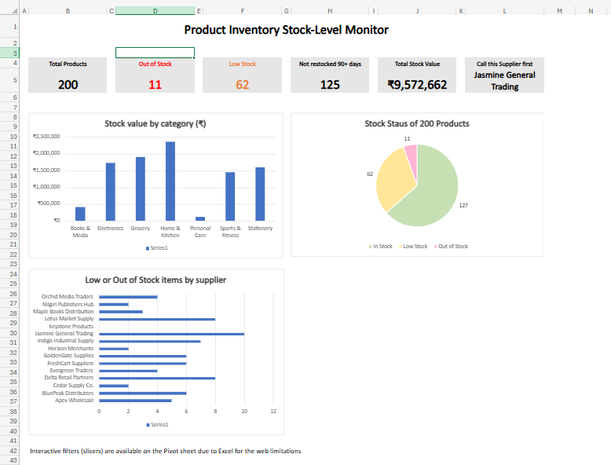
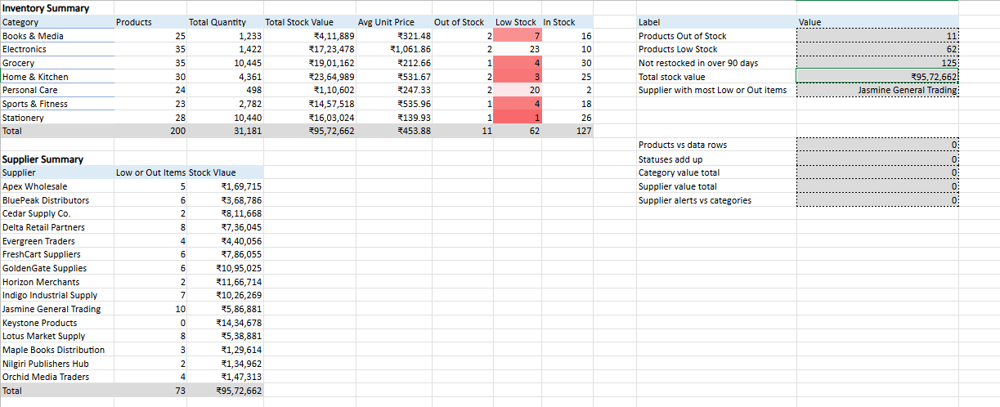

# Product Inventory Stock-Level Monitor

An Excel dashboard that monitors product stock levels, summarizes inventory value by category and supplier, and identifies products that need reordering.

**Snapshot date:** 27 October 2026

*Note: The snapshot date should reflect when the reported figures were actually verified. The workbook uses `TODAY()` for date-dependent calculations, so some figures may change when opened later.*

## Project Overview

Manually monitoring inventory can be time-consuming. This project uses Excel formulas, summaries, PivotTables, charts, and a dashboard to identify stock shortages and support inventory decisions.

## Dashboard

## Key Insights

- **200 products** across 7 categories and 15 suppliers.
- **73 products require attention:** 11 are out of stock and 62 are low in stock.
- Personal Care has 22 products with stock alerts, while Electronics has 25.
- Jasmine General Trading has the highest number of low-stock and out-of-stock products in the supplier summary.
- Total inventory stock value is approximately ₹95.73 lakh.

## Skills Demonstrated

- Data cleaning and text standardization
- Excel lookup and logical formulas
- Date calculations and stock-age monitoring
- Summary calculations using SUMIFS, COUNTIFS, and AVERAGEIFS
- Conditional formatting and data validation
- PivotTables, charts, and slicers
- Dashboard KPI cards and named ranges
- Dynamic reorder list using FILTER

## Workbook Sheets

The Excel workbook contains:

1. `Dashboard` — KPI cards and visual summary
2. `Summary` — Category and supplier summaries, totals, and checks
3. `Pivot` — PivotTables, charts, and slicers
4. `Reorder_List` — Products requiring attention
5. `Insights` — Business observations
6. `Inventory_Data` — Product inventory data
7. `Supplier_Master` — Supplier reference data
8. `Product_Master` — Product reference data
9. `Formula_Log` — Record of formulas used
10. `Data_Dictionary` — Column definitions

## Dataset

The dataset contains 200 synthetic products. It is intended for learning and demonstration, not for representing actual company inventory.

The original uncleaned source file could not be recovered. Do not treat a processed workbook or reference copy as the original raw file.

## Project Files

- `excel/inventory_stock_monitor.xlsx` — Complete workbook
- `docs/Inventory_Stock_Monitor_Report.pdf` — Project report
- `screenshots/` — Dashboard, summary, Pivot, inventory data, and reorder-list screenshots

## How to Use

Open the workbook in Microsoft Excel with support for the functions used, including FILTER. Review the Dashboard and Summary sheets. Use the Pivot sheet to explore the available PivotTables and slicers.

Refresh the PivotTables after updating the source data.

## Limitations

- Built in Excel Online; VBA macros were not implemented.
- Slicers remain on the Pivot sheet due to Excel Online limitations.
- Slicer filtering behavior should be described according to what was tested.
- Reorder thresholds are assumptions for the synthetic dataset.

## Future Improvements

- Automate refresh and reset actions.
- Improve interactive filtering and PivotChart integration in desktop Excel.
- Validate reorder thresholds using real sales and supplier lead-time data.
